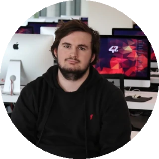

# Hi, I'm Benoît Cabocel

  

  

  <strong>Full-Stack Developer · Systems &amp; Networks · 42 Lyon Student</strong> 
  Looking for a 6-month C/C++ systems and networks internship - January 2027 
  Mobility: Lyon / Dijon · Permis B

  Dardilly, France ·
  <a href="mailto:benoit.cabocel.335@gmail.com">Email</a> ·
  <a href="https://benoit-cabocel.vercel.app/">Portfolio</a> ·
  <a href="https://benoit-cabocel.vercel.app/cv/benoit-cabocel-cv.pdf">CV</a> ·
  <a href="https://www.linkedin.com/in/benoit-cabocel/">LinkedIn</a>

---

## About Me

I'm a full-stack developer who builds complete products - from typed web interfaces and APIs to low-level C/C++ systems and networks. Currently at 42 Lyon, after a BUT MMI and a year as a full-stack apprentice.

I started in 2021 with a **BUT MMI** at IUT Dijon-Auxerre, where I learned web development, UI/UX and digital project management. I then joined **42 Lyon** to deepen my knowledge of algorithms, C/C++, Unix systems, networking and virtualization.

I enjoy working across different layers of software engineering:

- **Web:** TypeScript, Next.js, React, NestJS, Tailwind
- **Data:** PostgreSQL, MongoDB, Prisma, Redis
- **Real-time:** Socket.IO, Colyseus, Babylon.js
- **Infrastructure:** Docker, Nginx, TLS, S3, Linux
- **Systems & Networks:** C, C++, POSIX, Sockets, HTTP/1.1, memory management

I care about clean architecture, accessibility, internationalization, performance and teamwork.

---

## Projects

| Project                                                                                   | Description                                                                                                                                                                       | Technologies                                                                                           |
| ----------------------------------------------------------------------------------------- | --------------------------------------------------------------------------------------------------------------------------------------------------------------------------------- | ------------------------------------------------------------------------------------------------------ |
| [Light Keepers - Transcendence](https://github.com/transcendence-survivors/transcendence) | Final 42 project: a social platform with an embedded real-time multiplayer game, built by a team of four. Technical lead and product owner on the social network side.            | Next.js, NestJS, TypeScript, Prisma, PostgreSQL, Socket.IO, Babylon.js, Colyseus, Docker, Nginx, MinIO |
| [Webserv](https://github.com/dCben335-42-projects/Webserv)                                | Production-like HTTP/1.1 server in C++98 with Nginx-style config, virtual hosts, static content, CGI, uploads and non-blocking sockets. Built with two teammates.                 | C++98, HTTP/1.1, Sockets, CGI                                                                          |
| [Shellost](https://github.com/dCben335-42-projects/minishell)                             | Unix shell written from scratch in C on a custom libft: lexer, parser, AST, expansions, redirections, heredocs, pipelines, subshells, signals and builtins.                       | C, POSIX, libft                                                                                        |
| [cub3D](https://github.com/dCben335-42-projects/cub3d)                                    | Wolfenstein-inspired 3D raycasting engine with MiniLibX: two algorithms, custom interpolation, animated textures, minimap and runtime rendering tweaks. Playable via WebAssembly. | C, MiniLibX, WebAssembly                                                                               |
| [Inception](https://github.com/dCben335-42-projects/Inception)                            | Docker stack with TLS reverse proxy, WordPress, MariaDB, Redis, Adminer, FTP and Next.js SSR; every image built from scratch.                                                     | Docker, Nginx, MariaDB, Redis                                                                          |
| [Pokédex](https://github.com/dCben335/pokedex_front)                                      | Full Pokédex and trainer manager: Next.js frontend, Spring Boot + MongoDB API, filters, seen/caught tracking and an admin catalog.                                                | Next.js, Spring Boot, MongoDB                                                                          |
| **Websites Manager**                                                                      | Internal app built during my apprenticeship to monitor client websites, compare pages against references, detect changes and send alerts.                                         | Next.js, TypeScript, Prisma, PostgreSQL                                                                |
| **n8n Automation**                                                                        | n8n workflow for a wine producer centralizing orders, error alerts and data sync across platforms.                                                                                | n8n, APIs, Webhooks, Docker                                                                            |
| [Florian Mignot Portfolio](https://github.com/dCben335/Florian-MIGNOT-Portfolio)          | Portfolio with animated case studies, a Swiper gallery and a validated contact form, with a strong focus on typography and motion.                                                | Next.js, TypeScript, SCSS                                                                              |
| [André Delorme](https://andre-delorme.fr)                                                 | Custom WordPress e-commerce site built during my internship and upgraded during my apprenticeship, with ACF fields for wine details, tasting notes and delivery info.             | WordPress, WooCommerce, ACF, PHP, CSS                                                                  |
| **Sherlock Event**                                                                        | Visual identity, social posts, VIP invitations, posters and online ticketing site for a fictional Sherlock Holmes campus event.                                                   | PHP, Figma, Graphic design                                                                             |
| [Septième Dommage](https://septieme-dommage.fr)                                           | Visual identity, logo variants, wireframes and WordPress site for a card-game association; heavily modified since by the client, who still maintains it.                          | WordPress, Graphic design, Wireframes                                                                  |
| [Portfolio](https://benoit-cabocel.vercel.app/)                                           | Bilingual portfolio with interactive project showcases, a WebAssembly cub3D demo and full EN/FR content.                                                                          | Next.js, TypeScript, Tailwind CSS, next-intl, shadcn/ui                                                |

More systems and networking projects: **42 Piscine**, **BSQ**, **Shell** and **Rushes**.

---

## Tech Stack

| Area           | Technologies                                     |
| -------------- | ------------------------------------------------ |
| Web            | TypeScript, React, Next.js, NestJS, Tailwind CSS |
| Data           | PostgreSQL, MongoDB, Prisma, Redis               |
| Real-time & 3D | Socket.IO, Colyseus, Babylon.js                  |
| Infrastructure | Docker, Nginx, Linux, Git                        |
| Automation     | n8n, APIs, Webhooks                              |
| Systems        | C, C++, POSIX, Sockets, HTTP/1.1, Networking     |

---

## Experience

**Full-Stack Developer - Apprenticeship**  
IOTA Solutions · 2023–2024

- Built modern web applications and database models with Next.js, TypeScript, Prisma and PostgreSQL.
- Created automation workflows.
- Worked on accessibility audits and technical SEO.
- Managed projects autonomously and collaborated directly with clients.

**Full-Stack Developer - Internship**  
IOTA Solutions · 2023

- Integrated dynamic websites using Storyblok headless CMS.
- Developed custom modules and integrated e-commerce APIs.

---

## Education

- **Architecte en Technologie du Numérique** - 42 Lyon · 2024–present
- **BUT Métiers du Multimédia et de l'Internet** - IUT Dijon-Auxerre · 2021–2024
- **Baccalauréat Général** - Lycée Gustave Eiffel, Dijon · 2021

---

## Languages

- French - Native
- English - B2

---

## Beyond Code

Esport and competitive gaming · Manga and superhero pop culture · UI/UX and graphic design.

---

  <i>"Understanding how things work is just as important as making them work."</i>

  <a href="mailto:benoit.cabocel.335@gmail.com">Email</a> ·
  <a href="https://benoit-cabocel.vercel.app/">Portfolio</a> ·
  <a href="https://benoit-cabocel.vercel.app/cv/benoit-cabocel-cv.pdf">CV</a> ·
  <a href="https://github.com/dCben335">GitHub</a> ·
  <a href="https://www.linkedin.com/in/benoit-cabocel/">LinkedIn</a>

